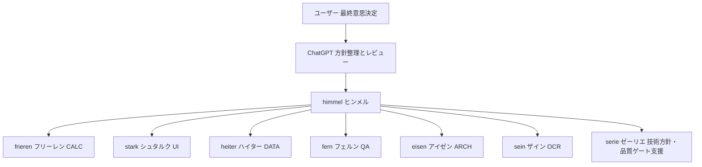

# 勇者一行 開発組織

ユーザー → ChatGPT（方針整理・レビュー）→ himmel（開発リーダー）→ 専門担当7人（第3段階でserieを追加）。仕様の最終承認はユーザーが持つ。

| 正式名 | 日本語名 | 責務 | 設定 |
|---|---|---|---|
| himmel | ヒンメル | 統括・委任・実装統合 | AGENTS.md、.codex/config.toml、roles/himmel.md |
| frieren | フリーレン | CALC | .codex/agents/frieren.toml |
| stark | シュタルク | UI | .codex/agents/stark.toml |
| heiter | ハイター | DATA | .codex/agents/heiter.toml |
| fern | フェルン | QA | .codex/agents/fern.toml |
| eisen | アイゼン | ARCH | .codex/agents/eisen.toml |
| sein | ザイン | OCR | .codex/agents/sein.toml |
| serie | ゼーリエ | 技術方針・品質ゲート判断支援 | roles/serie.md。今回collaborationで役割指示を明示、TOML登録なし |

現在は調査専用の役割設定。実際の起動・回収結果と自動設定読込の確認範囲は CAPABILITIES.md、RUN_REPORT.md、TASKS.md を参照。設定ファイルの存在を起動証明と扱わない。

開始手順：新しいCodexチャットをこのworktreeで開き、AGENTS.md、TASKS.mdを読む。himmelは .codex/agents/<name>.toml と roles/<name>.md を担当者に読ませ、依頼テンプレートを埋めて起動する。上限を確認して待ち合わせ、成果をreportsに記録する。agents API/CLI/Appごとの機能を混同しない。
