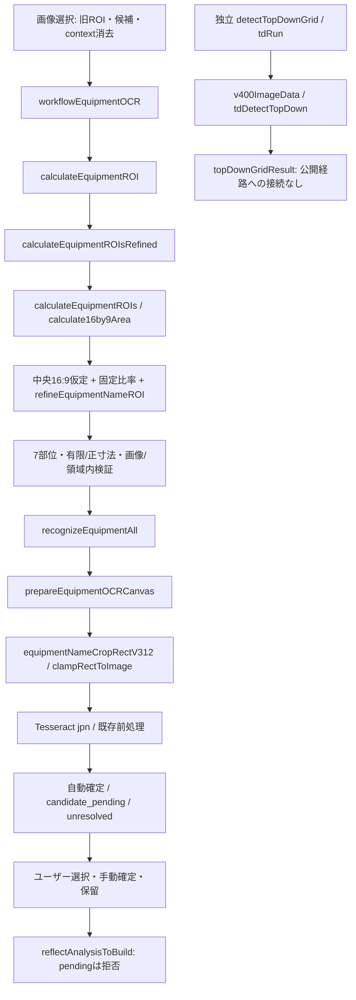

# OCR経路・座標監査

実画像goldenは0/3系統。矩形受渡しの補修を実機検出精度の完成とは扱わない。

## 公開経路

公開の中央16:9は黒帯・枠を実検出したviewportではない。独立トップダウンも画像全体基準でpitch/画像高・panel x/画像幅を評価し、正解viewportへ正規化する契約は未成立。9行仕様はmain/sub/head/chest/arms/waist/legs/charm/mantle。公開ROIはsub/mantleを除く7部位で、9行境界からの割当ではない。

| 座標層 | 現状 | 今回の扱い |
|---|---|---|
| 物理画像 | naturalWidth/naturalHeight | 原画素をcrop。CSSサイズを使わない |
| ゲームviewport | 中央最大16:9の仮定 | 不正矩形拒否。正しい画面境界の証明なし |
| 正規化座標 | 固定ROI比率/独立gridの全画像比率 | viewport基準の新校正値は追加しない |
| crop物理座標 | refined→明示w/h→icon-grid等 | 明示name ROIのw/hを保持、1px fallback防止 |

## 原因と最小修正

1. 未refined物理ROI `{x,y,w,h}`をcrop側がwidth/height扱いで読めず、1px幅のcard fallbackへ落ちる。明示w/hをclampし原画素帯を保持。refined最優先とicon-anchor契約を維持。係数変更なし。
2. 前画像のROI/grid、同画像再解析失敗後の旧確定候補/contextが残る。画像選択とROI算出開始で消去。画像src/File一致をworker開始後・通常pass開始前・公開前に確認。全await競合の網羅保証ではない。
3. 算出/認識失敗後もworkflowが完了表示へ進む。成功戻り値を確認して停止し、finallyでretryボタン復帰。
4. candidate/manual確定をdecision!='auto'だけで「要確認」と表示。resolutionStatusで自動/ユーザー/手動/保留を区別。再選択維持、画像VERIFIEDへ昇格しない。

## 画像識別・検証

関連worktree・指定r249候補・前チャット/Migrationバックアップ・DownloadsのMHWilds r249フォルダ/ZIPを探索。アイコン資産は原画像候補から除外。識別した4種類はSHA256でバックアップとの重複を確認。ZIPのig-b-counter-611.pngは戦闘根拠で装備9行原画像ではない。Downloads全体の一覧/ハッシュ処理は一度遅延し、対象を絞って確認。Mac全域を網羅したとは報告しない。

| 資産 | 分類 | 今回の結果 | golden |
|---|---|---|---|
| sample_game.png 1340×760 | 黒枠/白縁の装備画面 | 実OCR7部位/auto0、pending反映拒否・不変 | 未注釈 |
| examples/equipment_example.jpg 706×1536 | 縦部分拡大、ブラウザ/注釈混入 | 実OCR7部位/auto0、5防具manual反映一致、武器/護石保留 | viewport全体不明 |
| simulation_result.png 1099×623 | 旧検出枠重畳 | 原画像goldenに使用しない | 不採用 |
| examples/decoration_example.jpg 1536×864 | 装飾品選択。別名jpegと同hash | 装備名gridに使わない。装飾品E2E未実施 | 未確定 |
| 合成全画面/上下黒帯/枠撮影 | 既知viewportと色付き9行 | 3/3成功、全9行の原画素crop/CSS独立 | 合成truthのみ |

候補はevidence/image-candidates.json。viewport/9行境界/name bboxは未確定のためnull。推測で埋めない。実機原画像3系統を同等条件で検証できたとは扱わない。

9/24の3840×2160、viewport(0,0,3840,2160)、x184/w472/h69、Y309/708/903/1099/1294/1489/1693はユーザー提供の過去ROI参考記録。evidence/historical-4k-reference.jsonにNOT_GOLDENを付け、9行境界はnull。9/22の17.8%/8.7%/7.8%は提案値として保持。現行係数の校正に使用しない。

## 必要な撮影・注釈

- 全画面：メイン/サブ/5防具/護石/装衣の9行を全て含む実機原PNG。可能なら当時の4K原画像。リサイズ・OCR枠・ブラウザUIなし。ゲーム版、言語、表示倍率、撮影方式を記録。
- 上下黒帯：元解像度と黒帯を残し、ゲーム境界を独立注釈。9行の上下境界（10境界）と7装備名bboxを対応付ける。
- 枠撮影：枠と画面四隅、9行全体が見える未加工原画像。傾き/遠近を記録。切れた縦拡大写真から全viewportを推定しない。
- 同一画像SHA、viewport、9行境界、名前bboxを二者で照合し確認者・根拠を付けてgolden化。crop適合を先に判定し、Tesseract精度は後で評価。

P2：直接認識の再生成経路は検証前描画が残る（認識・確定は拒否）。例外時worker終了漏れと全await競合のブラウザ検証は別修正。
